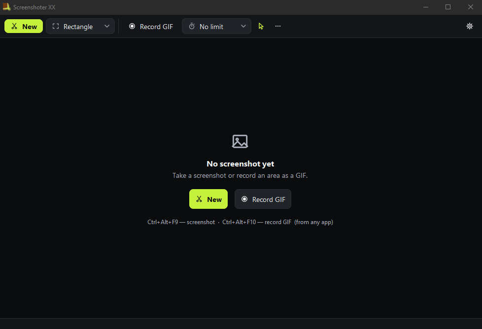
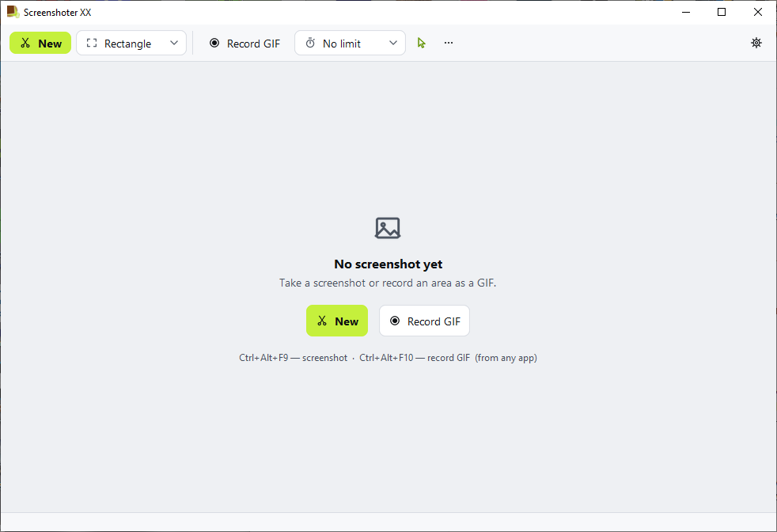
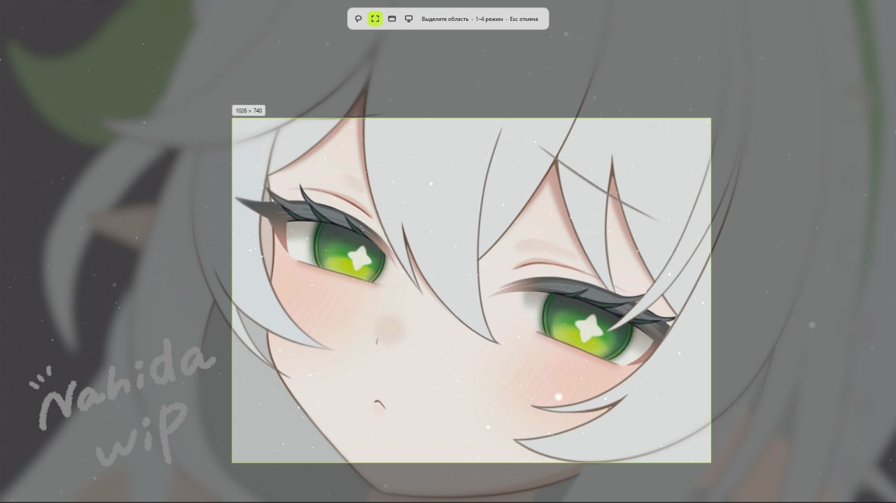

# ScreenShoterXX

**English** · [Русский](#русский)

An improved version of the Windows Snipping Tool — that can also **record GIFs**.
A clean interface, a built-in image editor with endless drawing, and a lot of new features.

| Dark theme | Light theme |
|---|---|
|  |  |

## Download

**[⬇ Download ScreenShoterXX.exe](https://github.com/KsandrXX/ScreenShoterXX/releases/latest)** — one file, no installation, Python not needed.

### "Windows protected your PC"?

Windows SmartScreen doesn't know the app because it isn't signed with a paid certificate.
Tell it to get lost: **More info → Run anyway**.

## Features

- **Snipping Tool, but better.** Free-form, rectangle, window or full screen. Every screenshot goes
  straight to the clipboard; saving to a folder is optional.
- **PrintScreen that actually works:** the active monitor straight to the clipboard, even where
  the usual PrintScreen fails. Your own global shortcuts — from any app.
- **GIF recording** of any area: pause, length limit, cursor on/off, frame rate and scale.
  The GIF is copied as a file — it pastes animated into messengers.
- **Image editor:** pen, highlighter, eraser (area or whole object), brush size up to 3600 px,
  opacity, a color palette with an eyedropper and swatches, undo/redo.
- **Endless drawing:** draw beyond the screenshot edges, smooth zoom with the mouse wheel,
  drag the canvas with the right mouse button.
- **Convenient interface:** dark and light themes, scale 100–200 %, English and Russian,
  runs in the tray, starts with Windows.
- **Coming soon: planning mode** — a canvas for several images at once.

## Running from source

Needs Python 3.8+ and Pillow: `pip install -r requirements.txt`.

| File | What it does |
|---|---|
| `Запуск.bat` | starts the app without a console window |
| `Конструктор настроек.bat` | settings designer: drag settings between sections and edit their texts (`settings_layout.json`) |
| `snipper.pyw` | the app itself: `python snipper.pyw`; `--showcase` — gallery of all interface components |
| `tools/build_exe.py` | builds `ScreenShoterXX.exe` (needs `pip install pyinstaller`) |

## License

[MIT](LICENSE) © [KsandrXX](https://github.com/KsandrXX)

---

# Русский

Улучшенная версия «Ножниц» из Windows, которая ещё и **записывает GIF**.
Удобный интерфейс, встроенный редактор изображений с бесконечным рисованием и куча новых функций.

## Скачать

**[⬇ Скачать ScreenShoterXX.exe](https://github.com/KsandrXX/ScreenShoterXX/releases/latest)** — один файл, без установки, Python не нужен.

### «Система Windows защитила ваш компьютер»?

Фильтр SmartScreen не знает программу, потому что она не подписана платным сертификатом.
Пошлите его: **Подробнее → Выполнить в любом случае**.

## Возможности

- **Ножницы, только лучше.** Произвольная форма, прямоугольник, окно или весь экран. Каждый снимок
  сразу в буфере обмена, сохранение в папку — по желанию.
- **PrintScreen, который работает:** снимок активного монитора сразу в буфер, даже там, где обычный
  PrintScreen не справляется. Свои глобальные сочетания — из любой программы.
- **Запись GIF** любой области: пауза, лимит длительности, курсор вкл/выкл, кадры в секунду и масштаб.
  GIF копируется файлом — в мессенджеры вставляется анимированным.
- **Редактор изображений:** перо, маркер, ластик (область или объект целиком), кисть до 3600 px,
  непрозрачность, палитра с пипеткой и образцами, отмена и повтор.
- **Бесконечное рисование:** рисуйте и за краями снимка, плавный зум колесом мыши,
  перетаскивание холста правой кнопкой.
- **Удобный интерфейс:** тёмная и светлая темы, масштаб 100–200 %, русский и английский,
  работа в трее, автозапуск с Windows.
- **Скоро: режим планирования** — холст для нескольких картинок сразу.

## Запуск из исходников

Нужны Python 3.8+ и Pillow: `pip install -r requirements.txt`.

| Файл | Что делает |
|---|---|
| `Запуск.bat` | запускает программу без окна консоли |
| `Конструктор настроек.bat` | конструктор настроек: перетаскивать настройки по разделам и менять их тексты (`settings_layout.json`) |
| `snipper.pyw` | сама программа: `python snipper.pyw`; `--showcase` — витрина всех элементов интерфейса |
| `tools/build_exe.py` | собирает `ScreenShoterXX.exe` (нужен `pip install pyinstaller`) |

## Лицензия

[MIT](LICENSE) © [KsandrXX](https://github.com/KsandrXX)
